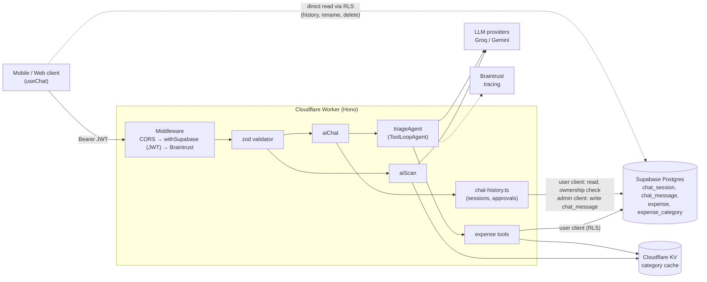
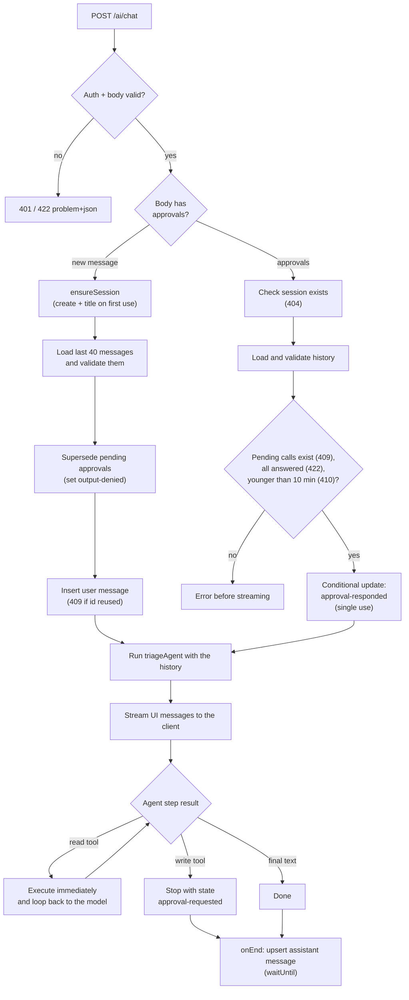
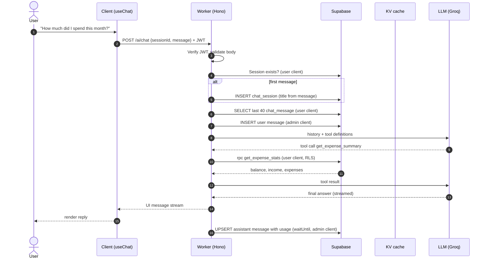
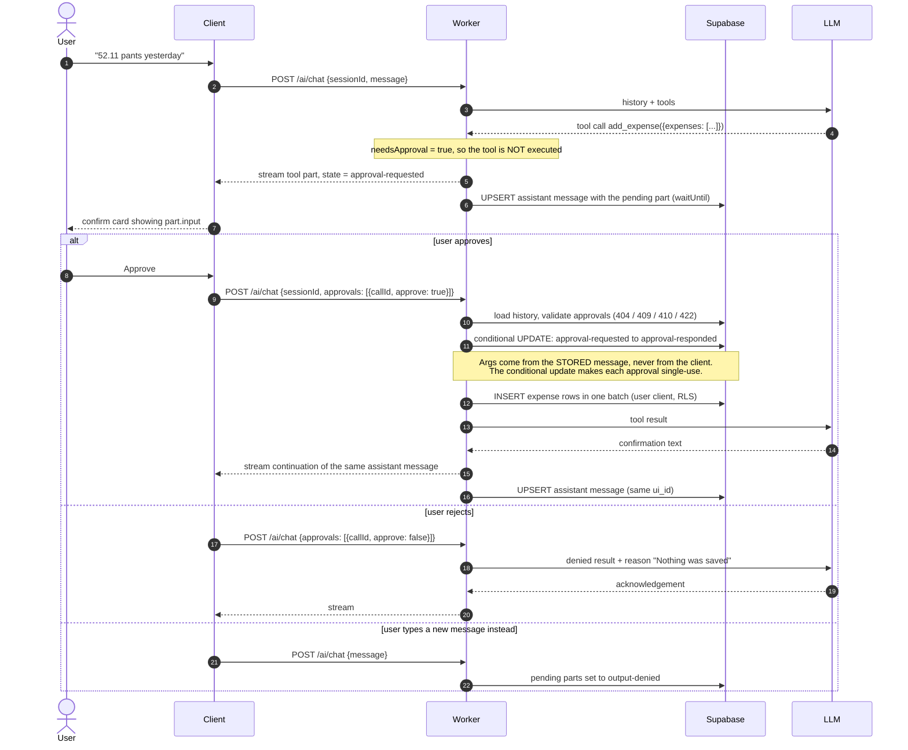
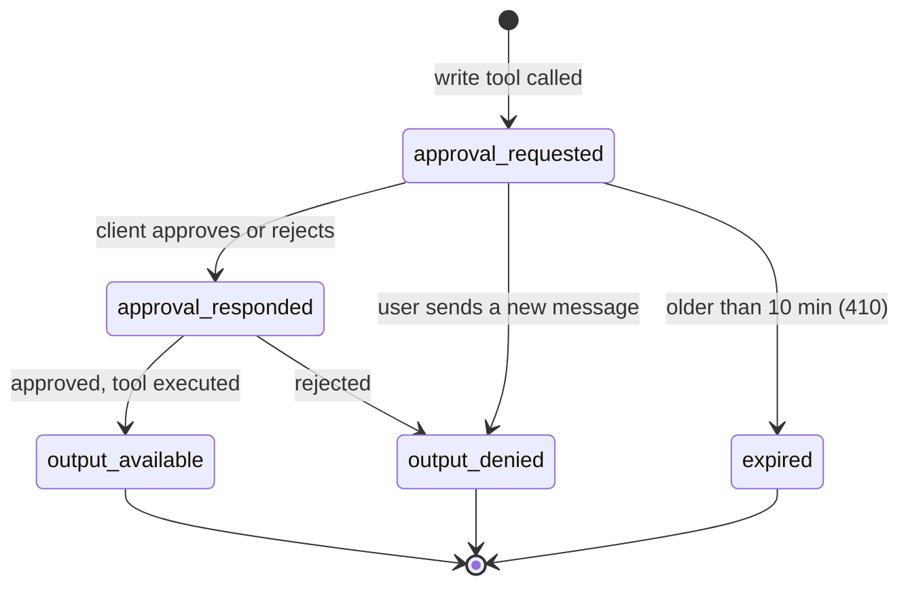
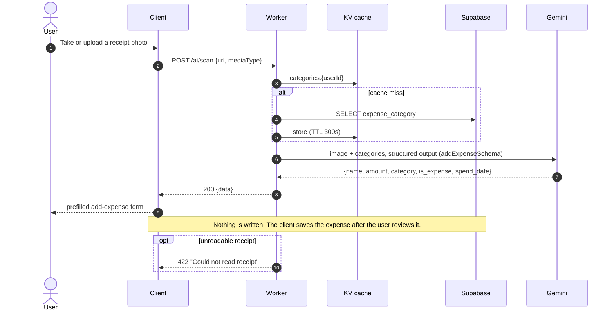

# Expense Tracker API

A Cloudflare Workers API (Hono + TypeScript) that powers an AI expense assistant. Users chat in natural language ("52.11 pants yesterday"), scan receipts, and the agent reads or changes their expenses in Supabase. Any action that writes data must be approved by the user first (human-in-the-loop).

- **Runtime:** Cloudflare Workers, with KV for caching
- **Framework:** Hono
- **AI:** Vercel AI SDK `ToolLoopAgent`, traced with Braintrust
- **Models:** Groq (chat agent), Gemini (receipt scan). Mercury and NVIDIA are also supported in `src/utils/model.ts`.
- **Data and auth:** Supabase (Postgres with RLS, JWT auth)

## Getting started

```txt
npm install
npm run dev          # wrangler dev (local state in .wrangler/)
npm run deploy       # wrangler deploy --minify
npm run cf-typegen   # regenerate worker-configuration.d.ts after editing wrangler.jsonc
```

Secrets live in `.dev.vars` locally. They include the Supabase settings, `GROQ_API_KEY`, `GEMINI_API_KEY`, `BRAINTRUST_API_KEY` and an optional `CORS_ORIGIN`. The model names and base URLs can be overridden in `src/constants/model-config.ts`.

Typecheck with `bunx --package typescript@5 tsc --noEmit`.

## Endpoints

| Endpoint | Purpose |
|---|---|
| `POST /ai/chat` | Send a message, or approve/reject pending actions. Streams the reply as an AI SDK UI message stream. |
| `POST /ai/scan` | Stateless receipt OCR. Returns a proposed expense for the client's form and writes nothing. |

The full client contract is in [`docs/chat-api.md`](docs/chat-api.md).

## How the system works

### 1. Architecture



**Two Supabase clients, on purpose**

| Client | Used for | Why |
|---|---|---|
| `supabase` (user-scoped) | Reads, expense tools, session ownership checks | RLS enforces that users only see their own rows. |
| `supabaseAdmin` (service role) | Writing `chat_message` | Users have no insert/update policy on `chat_message`, so a stored approval request cannot be tampered with. Every admin write is preceded by a user-scoped ownership check. |

### 2. Request flow for `POST /ai/chat`



### 3. Sequence: a normal message that reads data



### 4. Sequence: human-in-the-loop write (add, update, delete)

Write tools are declared with `needsApproval: true`. The agent never writes data by itself. The run stops, the client shows a confirm card, and the write happens only after the user approves.



**Approval state machine**



### 5. Sequence: receipt scan



## Key design decisions

- **The backend owns chat history.** The client sends only the new message or approval decisions. History is replayed from `chat_message` (last 40 rows), so a client cannot forge past turns or tool arguments.
- **One `UIMessage` per row.** Rows are keyed by `ui_id` (unique per session). An approval continuation updates the same assistant row in place via upsert.
- **Replies survive disconnects.** `consumeSseStream` drains a copy of the stream and `onEnd` saves the reply through `waitUntil`, so a client that goes away mid-stream does not lose the reply.
- **Stored history is validated on load** against the current tool `inputSchema` and `outputSchema`. Changing a tool's shape is a data migration, so add a script in `migrations/` that rewrites the stored `tool-<name>` parts.
- **Tools never take `user_id` from the model.** They close over the user-scoped client and inject the authenticated id.
- **Uniform tool output.** Every tool returns `{ ok, data | error }`. Error handlers must return that envelope too, because a bare string fails output validation and crashes the run.
- **KV is only for stable data.** Only the per-user category list is cached (5 min). KV is eventually consistent, so HITL state and balances stay in Supabase.
- **Errors are RFC 9457.** Responses use `application/problem+json` via `errorResponse`. Status codes come from `HTTP_STATUS`.

## Tools available to the agent

| Tool | Type | What it does |
|---|---|---|
| `list_expense_categories` | read | The user's categories |
| `list_expenses` | read | Filtered list of expenses and income |
| `get_expense` | read | One record by id |
| `get_expense_summary` | read | Balance, income and expenses for an optional year or month |
| `add_expense` | **write, needs approval** | Create one or more records (`{ expenses: [...] }`, one approval for all) |
| `update_expense` | **write, needs approval** | Edit a record |
| `delete_expense` | **write, needs approval** | Delete one or more records (`{ ids: [...] }`, one approval for all) |

## Project structure

```txt
src/
├── index.ts                     Hono app entry; mounts /ai
├── routes/ai.route.ts           CORS → withSupabase → braintrust → validators → handlers
├── middlewares/                 braintrust (tracing + waitUntil bridge), zod validator
├── services/ai/
│   ├── index.ts                 aiChat / aiScan handlers
│   ├── chat-history.ts          sessions, load/save messages, approval resolution
│   ├── agents/                  triage.agent.ts (used), expense.agent.ts (unused)
│   └── tools/expense.tools.ts   zod-typed tools + getCategories
├── schemas/                     zod schemas for requests and tools
├── constants/                   AI limits, cache TTLs, HTTP status, model config
├── libs/                        KV cache helper, response helpers
├── utils/                       model factory, date, json
└── types/                       shared types; database.ts is generated from Supabase
migrations/                      SQL for the shared Supabase project
docs/chat-api.md                 client contract
```

Contributor notes are in [`AGENTS.md`](AGENTS.md).
